AmparoMed
=========

Aplicativo Android de apoio ao cuidado de pacientes dependentes — idosos, acamados ou pessoas com necessidades contínuas de saúde. Centraliza os lembretes de medicação, o controle de estoque de remédios, o histórico de doses, os contatos de familiares e cuidadores e um acionamento rápido de emergência, reduzindo a sobrecarga de quem cuida e aumentando a segurança de quem é cuidado.


-003B57)


> Projeto acadêmico do curso de Análise e Desenvolvimento de Sistemas (ADS) da Universidade Cidade de São Paulo (UNICID).

Telas
-----

<p>
  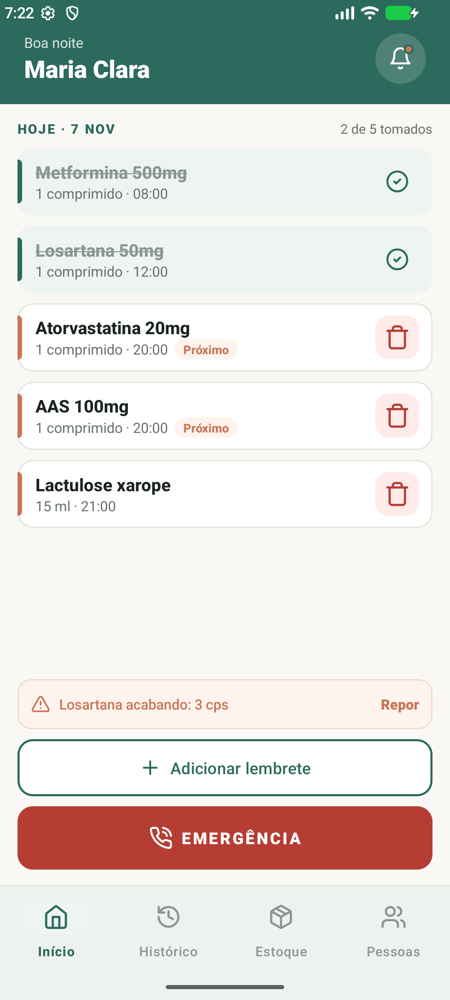
  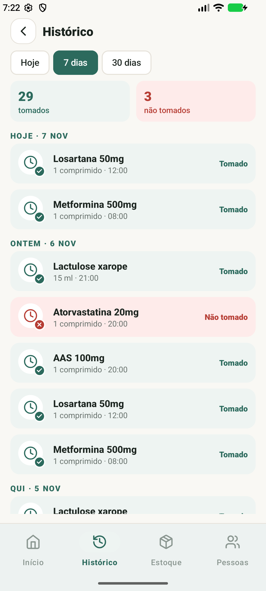
  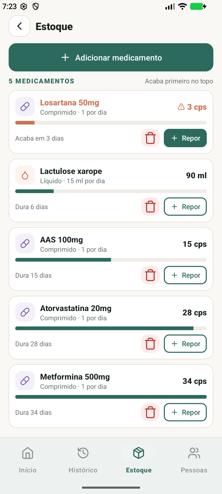
  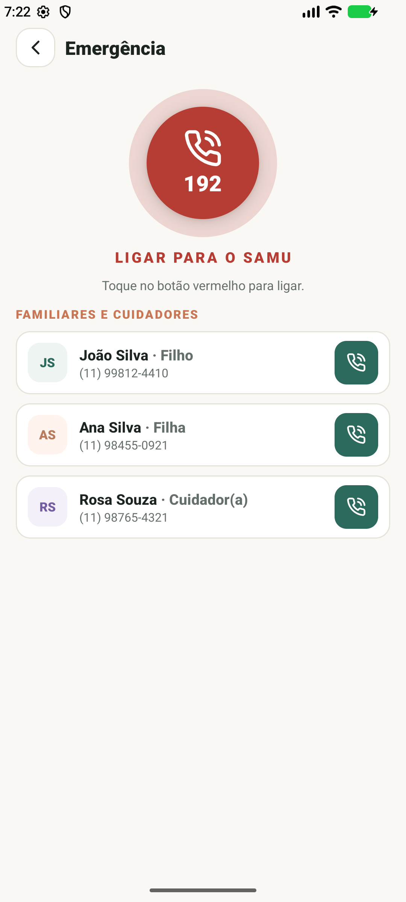
</p>

Sobre o projeto
---------------

Grande parte do cuidado domiciliar ainda é organizada à mão — anotações em papel, alarmes avulsos no celular ou a memória de quem cuida. Isso abre espaço para esquecimentos de medicação, falta de remédio em casa e demora para agir numa emergência. O **AmparoMed** nasceu para dar um apoio ativo ao cuidador, reunindo numa única plataforma simples o que antes ficava espalhado.

O app foi pensado em torno de três papéis:

| Papel | O que faz no app |
|---|---|
| **Paciente** | Pessoa cuidada. Tem perfil com dados, alergias e doenças; é o centro dos lembretes e do histórico. |
| **Cuidador** | Familiar ou cuidador profissional. Usa o app no dia a dia: confirma doses, controla estoque, aciona emergência. |
| **Contatos** | Familiares e cuidadores cadastrados, acionáveis rapidamente — inclusive na tela de emergência. |

Funcionalidades
---------------

- **Lembretes de medicação** por horário, com confirmação de dose (tomado / não tomado).
- **Controle de estoque** com aviso automático de remédio acabando e reposição rápida.
- **Histórico** de doses tomadas e não tomadas, com filtros (hoje / 7 dias / 30 dias).
- **Cadastro de medicamentos** (sólidos e líquidos) e de **lembretes**.
- **Pessoas**: perfil do paciente e lista de cuidadores/familiares, com cadastro e edição.
- **Emergência**: botão para o SAMU (192) e ligação rápida para os contatos (simulada no protótipo).
- **Login e cadastro** de usuário (telas visuais).
- **Persistência local** em banco de dados SQLite — os dados sobrevivem ao fechar o app.

Telas do app
------------

| Entrada | Início | Alarme |
|---|---|---|
| 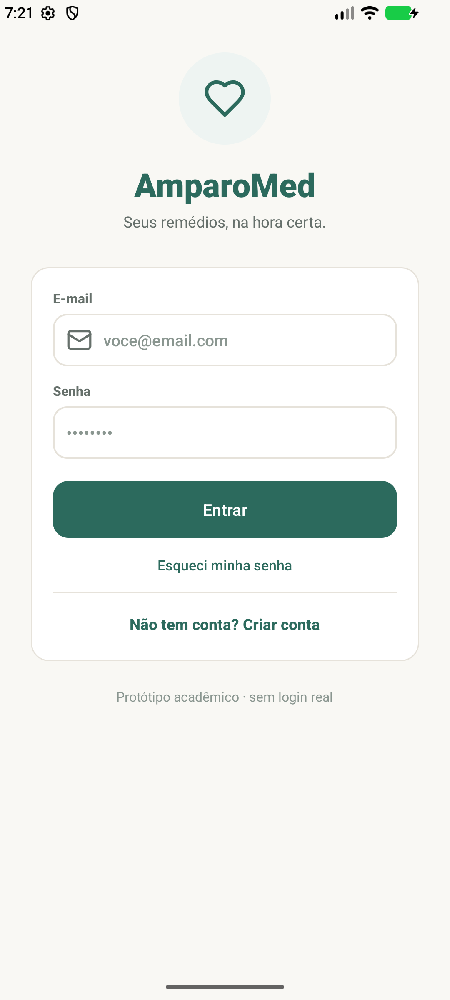 |  | 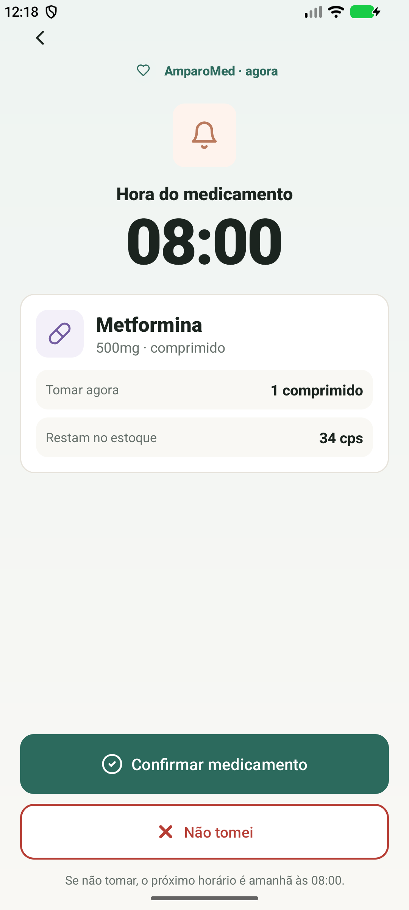 |

| Estoque | Cadastrar medicamento | Repor estoque |
|---|---|---|
|  | 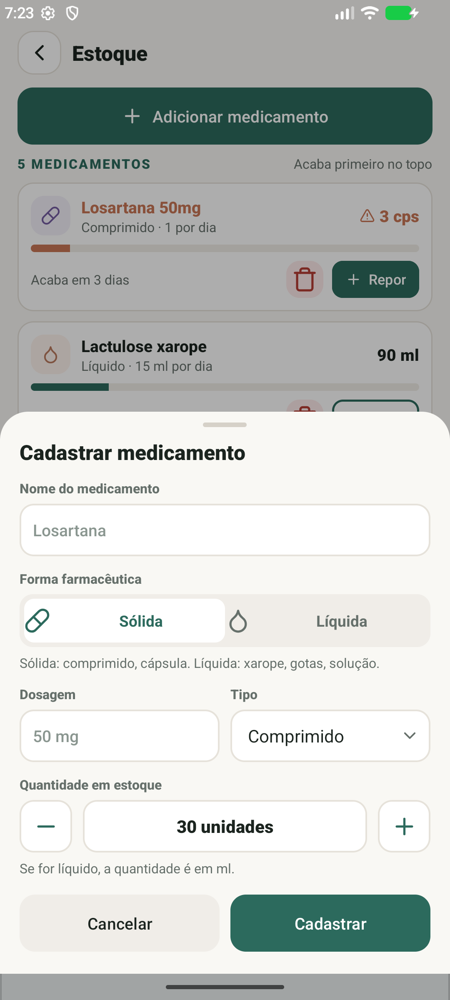 | 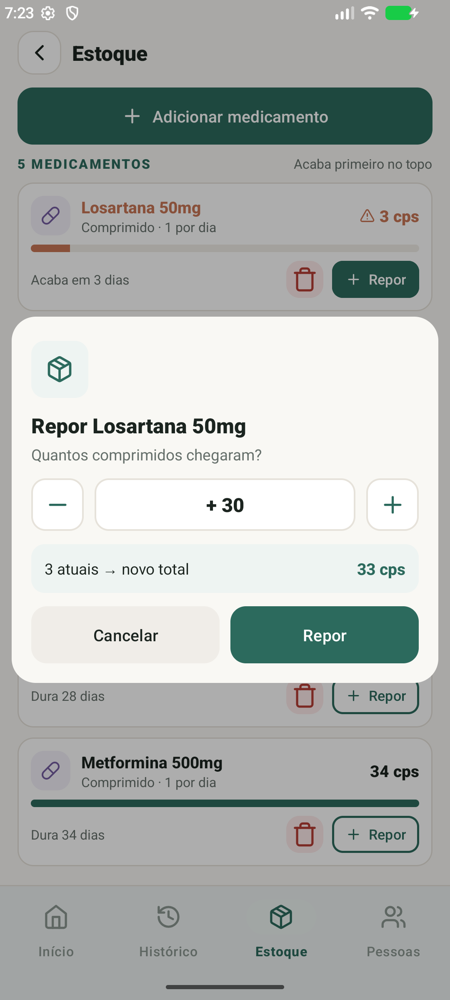 |

| Histórico | Pessoas (paciente) | Perfil do cuidador |
|---|---|---|
|  | 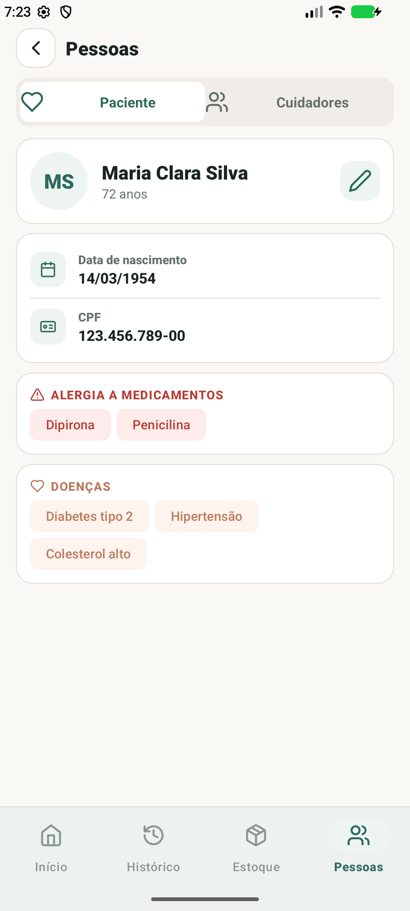 | 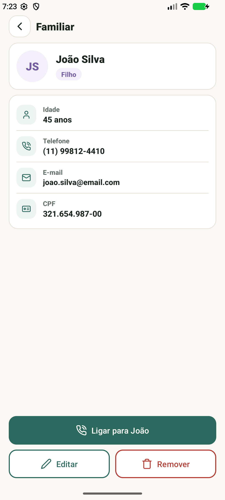 |

Arquitetura
-----------

O app segue uma separação clara entre interface, regra de negócio e persistência. A UI nunca fala direto com o banco: tudo passa pelo repositório.

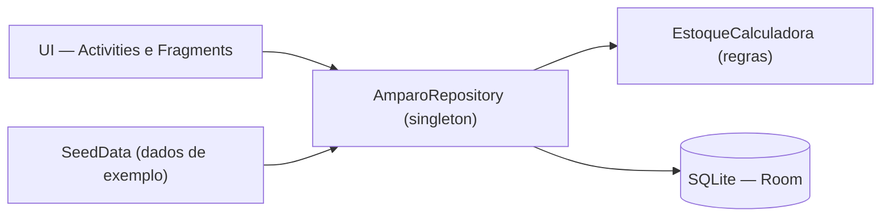

- **UI**: 4 abas (Início, Histórico, Estoque, Pessoas) dentro de uma `MainActivity` com `BottomNavigationView`; telas de detalhe (Alarme, Emergência, Perfil, Formulários) são Activities próprias.
- **Repositório**: ponto único de acesso aos dados. Mantém um cache em memória para a UI e faz *write-through* no banco a cada alteração.
- **Banco**: SQLite via **Room**. Na primeira abertura, o banco é semeado com dados de exemplo; depois, é carregado do disco.

Estrutura do repositório
------------------------

| Caminho | Conteúdo |
|---|---|
| `app/src/main/java/.../model` | Entidades (Medicamento, Lembrete, Cuidador, Paciente, RegistroDose) e enums. |
| `app/src/main/java/.../data` | Repositório, calculadora de estoque e dados de exemplo. |
| `app/src/main/java/.../data/db` | Banco Room: `AppDatabase`, DAOs e conversores de tipo. |
| `app/src/main/java/.../ui` | Telas: fragments das abas, activities de detalhe, adapters e diálogos. |
| `app/src/main/res` | Layouts, cores, estilos, ícones e drawables. |
| `design/` | Documentação e capturas de tela. |

Tecnologias
-----------

- **Linguagem**: Java 17.
- **Plataforma**: Android (minSdk 26, compileSdk/targetSdk 35).
- **UI**: XML com Views tradicionais e **Material 3** (sem Jetpack Compose).
- **Banco de dados**: **SQLite** via **Room** 2.6.
- **Build**: Gradle 8.9 / Android Gradle Plugin 8.7.3.
- Sem dependências de rede: o app funciona 100% offline.

Como rodar
----------

**Pré-requisitos:** Android Studio, JDK 21 e um emulador ou dispositivo com Android 8.0 (API 26) ou superior.

```bash
git clone https://github.com/0Luan0/AmparoMed.git
```

1. Abra o projeto no Android Studio (`File > Open` apontando para a pasta `AmparoMed`).
2. Quando perguntado, selecione **Use JVM 21** (o JDK 25 embutido é incompatível com o Gradle 8.9).
3. Aguarde o **Gradle Sync**.
4. Clique em **Run** (▶) e escolha um emulador arm64.

Banco de dados
--------------

Banco SQLite local (`amparomed.db`), criado pelo Room. Principais tabelas:

| Tabela | Guarda |
|---|---|
| `medicamento` | Remédios do estoque (nome, dosagem, forma, tipo, quantidade). |
| `lembrete` | Regras de quando tomar cada remédio (horário, intervalo, duração). |
| `registro_dose` | Histórico de doses tomadas e não tomadas. |
| `cuidador` | Familiares e cuidadores (contatos). |
| `paciente` | Dados do paciente (linha única). |

O que é real e o que é simplificado
-----------------------------------

- **Login e cadastro**: telas **visuais**, sem autenticação real (qualquer entrada abre o app). É um protótipo acadêmico.
- **Dados**: na primeira abertura, o app é populado com um cenário de exemplo (paciente, remédios, cuidadores e histórico). A partir daí, os dados ficam salvos no banco.
- **Ligações e emergência**: **simuladas** — o app mostra um diálogo em vez de discar. Num app real, o acionamento do 192 usaria `Intent.ACTION_DIAL`.

## Equipe AmparoMed

<p align="center">
  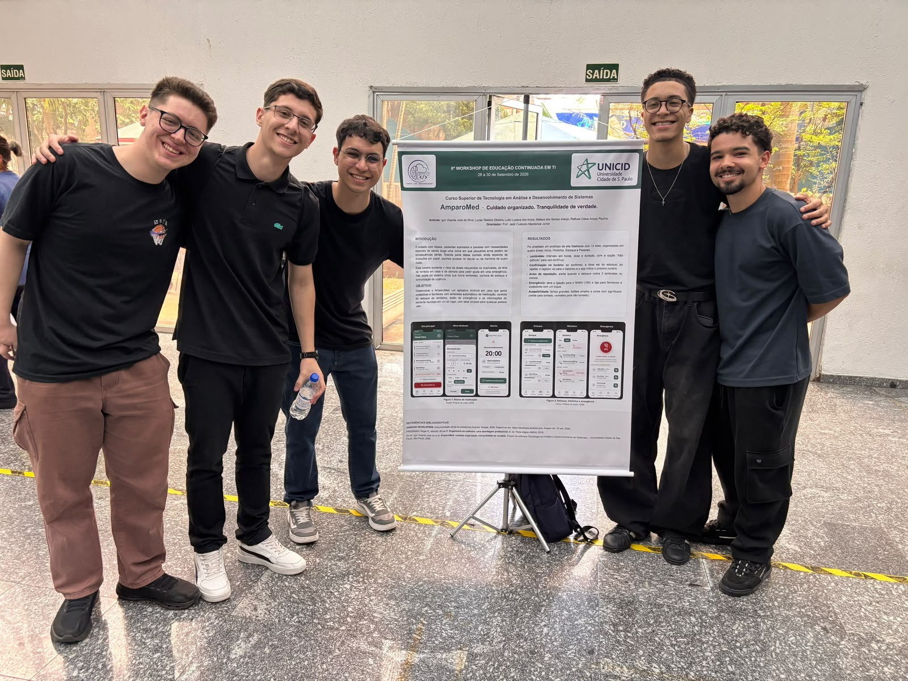
</p>

<p align="center">
  <strong>Equipe responsável pelo desenvolvimento do AmparoMed</strong>
</p>

### Conheça os integrantes

<table>
  <tr>
    <td align="center" width="50%">
      
      <br>
      <strong>Mateus dos Santos Araújo</strong>
      <br>
      <sub>Função: Líder e projetista de Banco de Dados</sub>
      <br>
      <a href="https://github.com/araujosantos20">@araujosantos20</a>
    </td>
    <td align="center" width="50%">
      
      <br>
      <strong>Igor Vicente José da Silva</strong>
      <br>
      <sub>Função: Analista</sub>
      <br>
      <a href="https://github.com/HARD2407">@Igor Vicente</a>
    </td>
    <td align="center" width="50%">
      
      <br>
      <strong>Lucas Teixeira Oliveira</strong>
      <br>
      <sub>Função: Desenvolvedor</sub>
      <br>
      <a href="https://github.com/Lucas0liveiraT">@Lucas0liveira</a>
    </td>
  </tr>
  <tr>
    <td align="center" width="50%">
      
      <br>
      <strong>Luan Lucena dos Anjos</strong>
      <br>
      <sub>Função: Testador</sub>
      <br>
      <a href="https://github.com/0Luan0">@0Luan0</a>
    </td>
    <td align="center" width="50%">
      
      <br>
      <strong>Rafhael César Araújo Paulino</strong>
      <br>
      <sub>Função: Documentador</sub>
      <br>
      <a href="https://github.com/_RafhaelCesar">@_RafhaelCesar</a>
    </td>
    <td></td>
  </tr>
</table>

---

### Informações acadêmicas

Projeto desenvolvido para a disciplina de **Desenvolvimento de Aplicações**, sob orientação do professor **Jadir Custodio Mendonça Júnior**, na **Universidade Cidade de São Paulo (UNICID)**.
