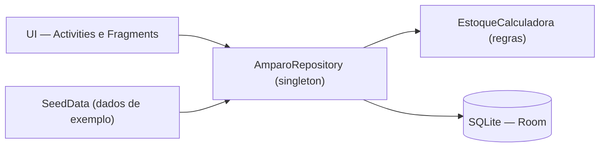

<div align="center">

# AmparoMed

**Apoio ao cuidado de pacientes dependentes: lembretes de medicação, controle de estoque, histórico de doses e acionamento rápido de emergência.**


-003B57?logo=sqlite&logoColor=white)


<p>
  
  
  
  
</p>

</div>

> Projeto acadêmico do curso de Análise e Desenvolvimento de Sistemas (ADS) da Universidade Cidade de São Paulo (UNICID).

## Sumário

- [Sobre o projeto](#sobre-o-projeto)
- [Funcionalidades](#funcionalidades)
- [Telas](#telas)
- [Arquitetura](#arquitetura)
- [Estrutura do repositório](#estrutura-do-repositório)
- [Tecnologias](#tecnologias)
- [Como executar](#como-executar)
- [Banco de dados](#banco-de-dados)
- [Escopo e limitações](#escopo-e-limitações)
- [Próximos passos](#próximos-passos)
- [Equipe](#equipe)
- [Informações acadêmicas](#informações-acadêmicas)

## Sobre o projeto

Grande parte do cuidado domiciliar ainda é organizada à mão: anotações em papel, alarmes avulsos no celular ou a memória de quem cuida. Esse cenário favorece esquecimentos de medicação, falta de remédio em casa e demora para agir em emergências.

O **AmparoMed** é um aplicativo Android que oferece apoio ativo ao cuidador, reunindo em uma única plataforma simples o que normalmente fica espalhado. O objetivo é reduzir a sobrecarga de quem cuida e aumentar a segurança de quem é cuidado.

### Papéis do sistema

| Papel | Descrição |
|---|---|
| **Paciente** | Pessoa cuidada. Possui perfil com dados, alergias e doenças, e é o centro dos lembretes e do histórico. |
| **Cuidador** | Familiar ou cuidador profissional. Usa o app no dia a dia para confirmar doses, controlar o estoque e acionar emergências. |
| **Contatos** | Familiares e cuidadores cadastrados, acionáveis rapidamente, inclusive pela tela de emergência. |

## Funcionalidades

**Medicação**
- Lembretes por horário, com confirmação de dose (tomado / não tomado).
- Cadastro de medicamentos (sólidos e líquidos) e de lembretes.
- Histórico de doses tomadas e não tomadas, com filtros de período (hoje, 7 dias e 30 dias).

**Estoque**
- Controle de estoque por medicamento.
- Aviso automático de remédio acabando.
- Reposição rápida.

**Pessoas e emergência**
- Perfil do paciente e lista de cuidadores/familiares, com cadastro e edição.
- Tela de emergência com botão para o SAMU (192) e ligação rápida para os contatos (simulada no protótipo).

**Geral**
- Telas de login e cadastro de usuário (apenas visuais).
- Persistência local em SQLite: os dados permanecem após o fechamento do app.
- Funcionamento 100% offline.

## Telas

<table align="center">
  <tr>
    <td align="center"><br /><sub><b>Login</b></sub></td>
    <td align="center"><br /><sub><b>Início</b></sub></td>
    <td align="center"><br /><sub><b>Alarme</b></sub></td>
  </tr>
  <tr>
    <td align="center"><br /><sub><b>Estoque</b></sub></td>
    <td align="center"><br /><sub><b>Cadastrar medicamento</b></sub></td>
    <td align="center"><br /><sub><b>Repor estoque</b></sub></td>
  </tr>
  <tr>
    <td align="center"><br /><sub><b>Histórico</b></sub></td>
    <td align="center"><br /><sub><b>Emergência</b></sub></td>
    <td align="center"><br /><sub><b>Pessoas (paciente)</b></sub></td>
  </tr>
  <tr>
    <td align="center"><br /><sub><b>Perfil do cuidador</b></sub></td>
    <td></td>
    <td></td>
  </tr>
</table>

## Arquitetura

O app mantém uma separação clara entre interface, regras de negócio e persistência. A UI nunca acessa o banco diretamente: todo acesso passa pelo repositório.



| Camada | Responsabilidade |
|---|---|
| **UI** | Quatro abas (Início, Histórico, Estoque e Pessoas) dentro de uma `MainActivity` com `BottomNavigationView`. As telas de detalhe (Alarme, Emergência, Perfil e Formulários) são Activities próprias. |
| **Repositório** | Ponto único de acesso aos dados. Mantém um cache em memória para a UI e faz *write-through* no banco a cada alteração. |
| **Regras de negócio** | `EstoqueCalculadora` concentra os cálculos e as regras de estoque. |
| **Banco de dados** | SQLite via Room. Na primeira abertura, o banco é populado com dados de exemplo; nas seguintes, é carregado do disco. |

## Estrutura do repositório

| Caminho | Conteúdo |
|---|---|
| `app/src/main/java/.../model` | Entidades (`Medicamento`, `Lembrete`, `Cuidador`, `Paciente`, `RegistroDose`) e enums. |
| `app/src/main/java/.../data` | Repositório, calculadora de estoque e dados de exemplo. |
| `app/src/main/java/.../data/db` | Banco Room: `AppDatabase`, DAOs e conversores de tipo. |
| `app/src/main/java/.../ui` | Fragments das abas, Activities de detalhe, adapters e diálogos. |
| `app/src/main/res` | Layouts, cores, estilos, ícones e drawables. |
| `design/` | Documentação e capturas de tela. |
| `docs/equipe/` | Fotos da equipe utilizadas neste README. |

## Tecnologias

| Categoria | Tecnologia |
|---|---|
| Linguagem | Java 17 |
| Plataforma | Android (minSdk 26, compileSdk/targetSdk 35) |
| Interface | XML com Views tradicionais e Material 3 (sem Jetpack Compose) |
| Banco de dados | SQLite via Room 2.6 |
| Build | Gradle 8.9 e Android Gradle Plugin 8.7.3 |
| Rede | Nenhuma dependência: o app funciona 100% offline |

## Como executar

### Pré-requisitos

- [Android Studio](https://developer.android.com/studio)
- JDK 21
- Emulador ou dispositivo com Android 8.0 (API 26) ou superior

### Passo a passo

1. Clone o repositório:

   ```bash
   git clone https://github.com/0Luan0/AmparoMed.git
   cd AmparoMed
   ```

2. Abra o projeto no Android Studio (`File > Open`, apontando para a pasta `AmparoMed`).
3. Quando solicitado, selecione **Use JVM 21**.
4. Aguarde a conclusão do **Gradle Sync**.
5. Clique em **Run** (▶) e escolha um emulador arm64.

> [!IMPORTANT]
> O JDK 25 embutido em algumas versões do Android Studio é incompatível com o Gradle 8.9. Caso a build falhe, confirme em `Settings > Build, Execution, Deployment > Build Tools > Gradle` que o **Gradle JDK** está configurado para a versão 21.

## Banco de dados

O app utiliza um banco SQLite local (`amparomed.db`), criado e gerenciado pelo Room.

| Tabela | Conteúdo |
|---|---|
| `medicamento` | Remédios do estoque (nome, dosagem, forma, tipo e quantidade). |
| `lembrete` | Regras de quando tomar cada remédio (horário, intervalo e duração). |
| `registro_dose` | Histórico de doses tomadas e não tomadas. |
| `cuidador` | Familiares e cuidadores (contatos). |
| `paciente` | Dados do paciente (linha única). |

## Escopo e limitações

Por se tratar de um protótipo acadêmico, alguns recursos são intencionalmente simplificados:

| Recurso | Situação atual |
|---|---|
| **Login e cadastro** | Telas visuais, sem autenticação real. Qualquer entrada abre o app. |
| **Dados iniciais** | Na primeira abertura, o app é populado com um cenário de exemplo (paciente, remédios, cuidadores e histórico). A partir daí, os dados ficam salvos no banco. |
| **Ligações e emergência** | Simuladas: o app exibe um diálogo em vez de discar. |

## Próximos passos

- [ ] Implementar autenticação real de usuários.
- [ ] Acionar o SAMU (192) e os contatos de forma real, utilizando `Intent.ACTION_DIAL`.

## Equipe

<p align="center">
  
  <br>
  <sub><b>Equipe responsável pelo desenvolvimento do AmparoMed</b></sub>
</p>

<table>
  <tr>
    <td align="center" width="33%">
      
      <br>
      <strong>Mateus dos Santos Araújo</strong>
      <br>
      <sub>Líder e projetista de Banco de Dados</sub>
      <br>
      <a href="https://github.com/araujosantos20">@araujosantos20</a>
    </td>
    <td align="center" width="33%">
      
      <br>
      <strong>Igor Vicente José da Silva</strong>
      <br>
      <sub>Analista</sub>
      <br>
      <a href="https://github.com/HARD2407">@HARD2407</a>
    </td>
    <td align="center" width="33%">
      
      <br>
      <strong>Lucas Teixeira Oliveira</strong>
      <br>
      <sub>Desenvolvedor</sub>
      <br>
      <a href="https://github.com/Lucas0liveiraT">@Lucas0liveiraT</a>
    </td>
  </tr>
  <tr>
    <td align="center" width="33%">
      
      <br>
      <strong>Luan Lucena dos Anjos</strong>
      <br>
      <sub>Testador</sub>
      <br>
      <a href="https://github.com/0Luan0">@0Luan0</a>
    </td>
    <td align="center" width="33%">
      
      <br>
      <strong>Rafhael César Araújo Paulino</strong>
      <br>
      <sub>Documentador</sub>
      <br>
      <a href="https://github.com/RafhaelCesar">@RafhaelCesar</a>
    </td>
    <td></td>
  </tr>
</table>

## Informações acadêmicas

| | |
|---|---|
| **Instituição** | Universidade Cidade de São Paulo (UNICID) |
| **Curso** | Análise e Desenvolvimento de Sistemas (ADS) |
| **Disciplina** | Desenvolvimento de Aplicações |
| **Orientador** | Prof. Jadir Custodio Mendonça Júnior |
